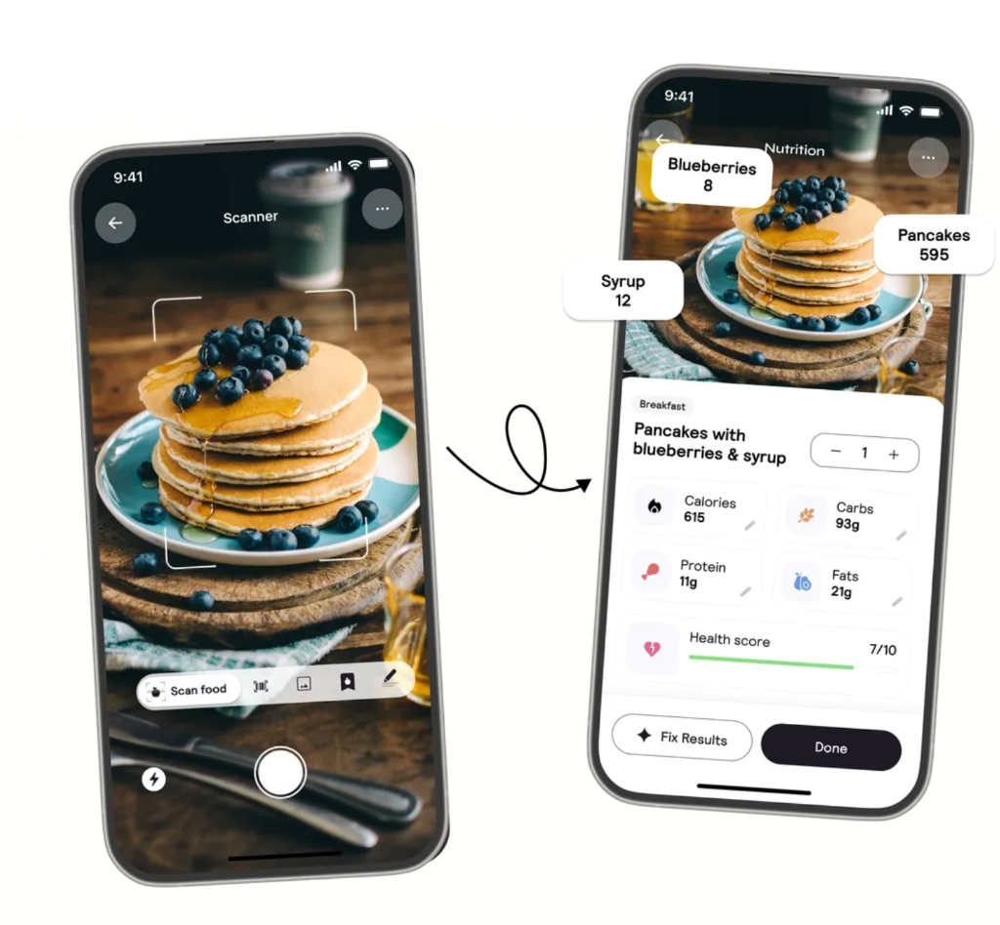

# Snap 📸 — Open-Source AI Calorie & Macro Tracker

> **A local-first, privacy-focused visual calorie tracker built with React Native & Expo.** Photograph any meal, get an immediate calorie and macro breakdown with AI vision, and track your daily nutrition goals with 100% on-device privacy.

<p align="center">
  
</p>

<p align="center">
  <a href="https://github.com/authrain-cloud-abdullahformuli/snap-calories/blob/main/LICENSE"></a>
  
  
  
  
</p>

---

## ✨ Features

- 📸 **Visual Multi-Item Food Recognition:** Snap a photo or choose from your gallery. Multi-modal AI segments complex meals into distinct ingredients, portion estimates, and macro breakdowns (Calories, Protein, Carbs, Fats).
- 🔒 **100% Local-First & Zero Middleman:** Your photos, logs, targets, and personal data stay strictly on your device in local SQLite. The only network request is the direct photo estimate sent straight to your chosen AI provider using **your own API key**.
- 🤖 **Dual Provider Support (Gemini + Claude):**
  - **Google Gemini Flash:** Fast and operates on Google's generous **free tier** (no credit card needed).
  - **Anthropic Claude 3.5 Sonnet:** High-precision vision parsing for complex culinary dishes.
  - Auto-detects your key provider automatically upon paste.
- 🎯 **Scientific BMR & Macro Calculator:** Uses the Mifflin-St Jeor formula adjusted for activity level and fitness goals (Cut, Maintain, Bulk).
- 🏷️ **Likely Hidden Ingredients Detection:** AI flags invisible cooking oils, dressings, syrups, and butters that usually ruin calorie counts, letting you add them with a single tap.
- ⚡ **Instant Expo Go Support:** Test directly on your iOS or Android phone in seconds without compiling native code or opening Xcode / Android Studio.
- 💾 **Full Data Ownership:** Export your entire diary anytime as structured JSON or wipe data with a single button.

---

## 🚀 Quick Start

### Prerequisites
- **Node.js 20+**
- **Expo Go** app installed on your iPhone ([App Store](https://apps.apple.com/app/expo-go/id982107779)) or Android ([Play Store](https://play.google.com/store/apps/details?id=host.exp.exponent))

### Installation

```bash
# Clone the repository
git clone https://github.com/authrain-cloud-abdullahformuli/snap-calories.git
cd snap-calories

# Install dependencies
npm install

# Start the Expo development server
npm start
```

Scan the terminal QR code with **Expo Go** (Android) or the native **Camera app** (iOS).

---

## 🔑 Adding Your API Key

Snap connects directly to the AI provider from your device without any proxy server. You can choose either:

| Provider | Cost | Where to get it |
|---|---|---|
| **Google Gemini** | **Free tier** (No credit card required) | [Google AI Studio](https://aistudio.google.com/apikey) |
| **Anthropic Claude** | Paid (API credits required) | [Anthropic Console](https://console.anthropic.com/settings/keys) |

### 1. In the App (Recommended)
Paste your key during initial onboarding or under **Settings → API key**. Keys are stored securely in hardware-backed device storage (`expo-secure-store`) and are never written to unencrypted logs or SQLite.

### 2. Local `.env` (Development)
For local development, copy the environment template:
```bash
cp .env.example .env
# Open .env and add your key
npm start
```

---

## 🛠️ Project Architecture

```text
├── app/                  # File-based routing (Expo Router)
│   ├── (tabs)/           # Main screens: Today, Diary, Profile/Settings
│   ├── capture.tsx       # Real-time camera viewfinder & photo picker
│   ├── review.tsx        # Cal AI-style breakdown with item editing & macro sliders
│   └── manual.tsx        # Manual meal logging
├── src/
│   ├── api/              # Multimodal AI vision transports (Gemini & Anthropic)
│   │   ├── anthropic.ts  # Claude Messages API client
│   │   ├── gemini.ts     # Gemini Flash API client
│   │   ├── prompt.ts     # System instructions & JSON schema constraints
│   │   └── keyStore.ts   # Secure hardware keychain storage
│   ├── db/               # Local SQLite database (schema, queries, migrations)
│   ├── logic/            # Mifflin-St Jeor BMR, macro distributions, scaling
│   ├── store/            # Lightweight Zustand state management
│   └── components/       # Custom accessible UI components & theme tokens
└── assets/               # Branding, icons, and visual demo assets
```

---

## 💻 Available Scripts

```bash
npm start        # Launch Expo dev server with interactive terminal UI
npm run android  # Open in Android emulator / device
npm run ios      # Open in iOS simulator (macOS only)
npm run web      # Web preview mode
npm run typecheck# Run TypeScript compiler checks
npm run doctor   # Verify Expo dependency health
```

---

## 🛡️ Privacy & Security

- **No Analytics / No Tracking:** Zero third-party telemetry, ads, or cookies.
- **Client-Only Architecture:** Your biometric data, meal history, and API keys never touch any intermediary backend.
- **Hardware Keychain:** API keys are persisted via iOS Keychain / Android Keystore through `expo-secure-store`.

---

## 👨‍💻 Author

**Abdullah Formuli**
- GitHub: [@authrain-cloud-abdullahformuli](https://github.com/authrain-cloud-abdullahformuli)
- X / Twitter: [@abdullahformuli](https://x.com/abdullahformuli)

---

## 📄 License

This project is open-source under the [MIT License](./LICENSE).
